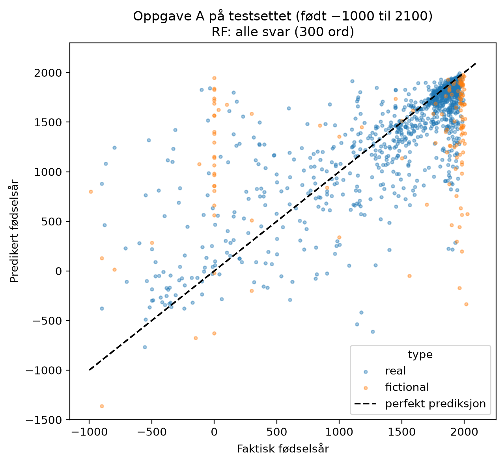
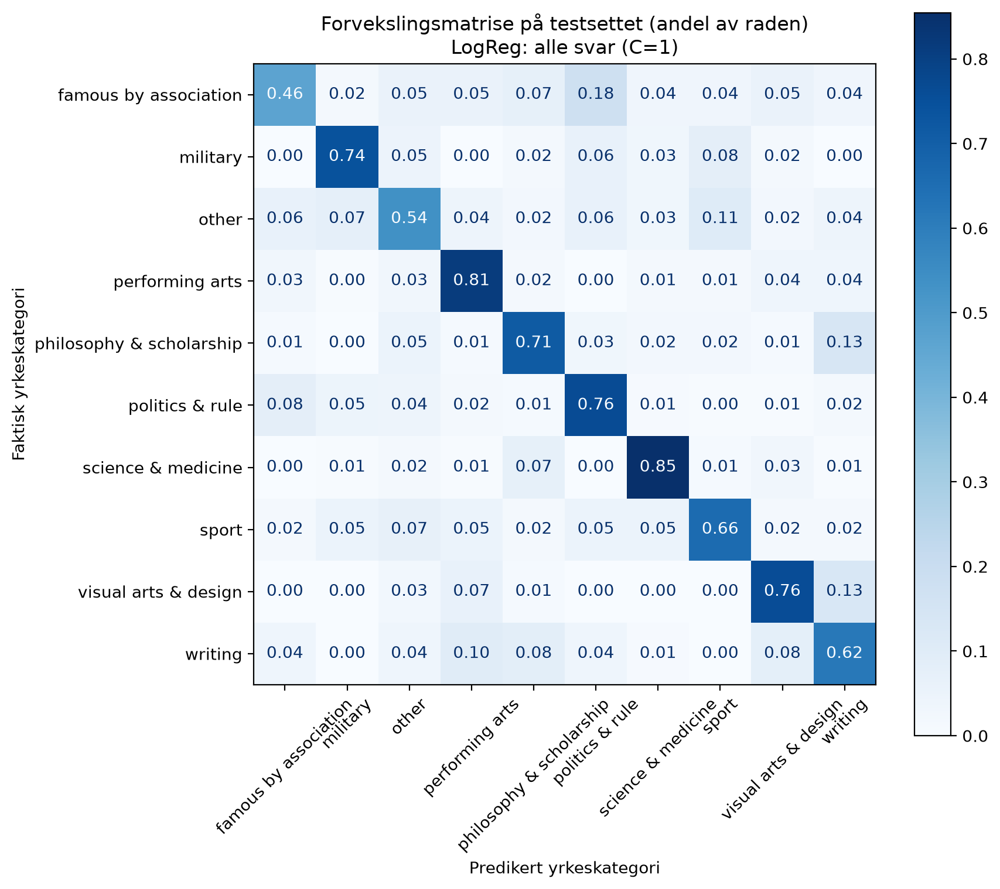

# Hva tror en språkmodell om historiske personaer?

En språkmodell har svart på 62 spørsmål *som om den var* hver av 10 000 kjente personer og fiktive figurer. Prosjektet undersøker hva svarene sier om språkmodellens bilde av historien, og om svarene alene kan predikere **når personen levde** og **hva personen drev med**.

Sluttprosjekt i **INF161 – Data Science** ved Universitetet i Bergen, høsten 2026. Hele rapporten ligger i `rapport_prosjekt.pdf`.

## Resultater

| Oppgave | Valgt modell | Testsettet | Baseline |
| --- | --- | --- | --- |
| A: fødselsår (regresjon) | Random Forest, alle svar + TF-IDF | MAE **285 år** | MAE 452 år |
| B: yrkeskategori (10 klasser) | Logistisk regresjon, alle svar + TF-IDF | Balanced accuracy **0,692** | 0,100 |

<p align="center">
  
  
</p>

## Metode

- 70/15/15-splitt i trening, validering og test, stratifisert på yrkeskategori
- All forbehandling i én scikit-learn-`Pipeline`, slik at ingenting lekker fra validerings- og testdata
- Sammenlignet lineære modeller, SGD og Random Forest mot en baseline. Modellen ble valgt på valideringssettet og sjekket med kryssvalidering

## Funn

- Fritekstsvarene er den viktigste informasjonskilden i begge oppgavene.
- `last_meal` avslører epoken best: språkmodellen lar historiske personer velge mat fra sin egen tid.
- Fiktive figurer og personer fra antikken gir de største feilene.
- Modellene beskriver hva *språkmodellen* tror, ikke egenskaper ved de virkelige personene.

## Kjøring

```bash
pip install -r requirements.txt
jupyter notebook main.ipynb
```

Legg `persona_survey.csv` i samme mappe som notebooken. Datasettet er gitt i emnet og er ikke med i repoet.

## Forfatter

Eirik Aarrestad – bachelor i statistikk og data science, UiB
